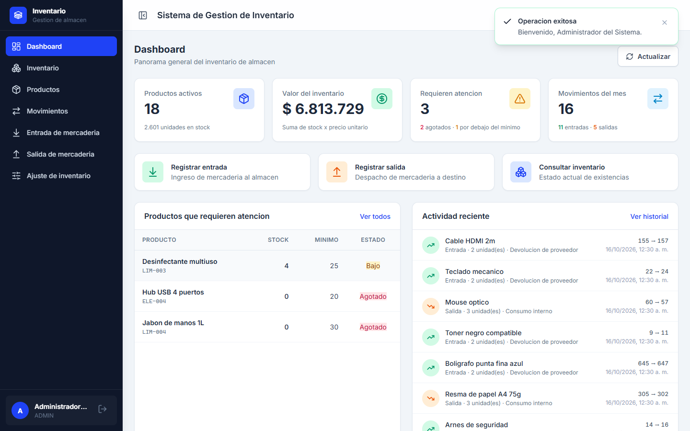

# Sistema de Gestión de Inventario

Aplicación para registrar entradas y salidas de mercadería y consultar el
estado actual del inventario de un almacén.

La lógica de negocio no está en la aplicación: vive en 20 rutinas PL/pgSQL de
PostgreSQL. La API en C# valida, coordina y traduce errores; el frontend consume una
API REST documentada.

| Capa | Tecnología |
|---|---|
| Base de datos | PostgreSQL 16 — 5 tablas, 20 rutinas PL/pgSQL, 21 índices |
| Backend | ASP.NET Core Web API (.NET 8) — Dapper + Npgsql, JWT Bearer, Swagger |
| Frontend | Angular 22 (standalone + signals) — CSS propio, Lucide vía `@ng-icons` |
| Pruebas | 204 (Jest) + 21 (xUnit) = 225, con 92 % de cobertura en el frontend |



---

## 1. Qué hace

| Módulo | Qué permite |
|---|---|
| **Autenticación** | Login con JWT (access + refresh), tres roles (`ADMIN`, `OPERADOR`, `LECTURA`), cierre de sesión |
| **Dashboard** | KPIs, valor del inventario, productos que requieren atención y actividad reciente |
| **Inventario** | Consulta con búsqueda, filtros por categoría y stock, ordenamiento y paginación |
| **Productos** | Alta, edición y baja lógica del catálogo (editar nunca altera el stock) |
| **Movimientos** | Entradas, salidas y ajustes por conteo físico, con bitácora auditable |
| **Historial** | Movimientos filtrables por producto, tipo, texto libre y rango de fechas |

En escritorio la barra lateral se pliega a una columna de iconos; en móvil las tablas
se convierten en tarjetas y el menú es deslizante.

---

## 2. Puesta en marcha

**Requisitos:** .NET SDK 8+ · Node.js 20+ · npm 10+ · PostgreSQL 14+

```bash
# 1. Base de datos
psql -U postgres -h localhost -f database/00_crear_base_datos.sql
createdb -U postgres -h localhost -O inventario inventario_db
cd database
psql -U inventario -h localhost -d inventario_db -f 01_schema.sql
psql -U inventario -h localhost -d inventario_db -f 02_stored_procedures.sql
psql -U inventario -h localhost -d inventario_db -f 03_seed.sql
# para recrearla desde cero: -f reset.sql

# 2. API  ->  http://localhost:5099   (Swagger en /swagger, health en /health)
cd backend && dotnet run --project Inventario.API

# 3. Frontend  ->  http://localhost:4200
cd frontend && npm install && npm start
```

**Credenciales de prueba**

| Usuario | Contraseña | Rol | Permisos |
|---|---|---|---|
| `admin` | `Admin123!` | ADMIN | Acceso total, incluida la baja de productos |
| `operador` | `Operador123!` | OPERADOR | Registrar entradas, salidas y ajustes |
| `lector` | `Lector123!` | LECTURA | Solo consultar |

Guía paso a paso: [`docs/GUIA_DE_DESPLIEGUE.md`](docs/GUIA_DE_DESPLIEGUE.md)

---

## 3. Requisitos e implementación

| Requisito | Dónde se resuelve |
|---|---|
| Base de datos PostgreSQL con productos y movimientos | `database/01_schema.sql` — 5 tablas, 21 índices, `ENUM`, trigger de `updated_at` |
| API RESTful en C# para entrada, salida y consulta de inventario | `backend/Inventario.API/Controllers/` — 4 controllers, 15 endpoints (§6) |
| Entity Framework o Dapper | Dapper en `backend/Inventario.Infrastructure/Repositories/` |
| Stored procedures para entradas, salidas y estado actual | `database/02_stored_procedures.sql` — `sp_registrar_entrada`, `sp_registrar_salida`, `sp_registrar_ajuste`, `sp_consultar_inventario_actual` |
| Frontend en JavaScript con las 3 operaciones | `frontend/src/app/features/` (TypeScript, que compila a JavaScript) |
| Stored procedures usados para las operaciones | Toda escritura pasa por un procedimiento; el stock nunca se calcula en C# |
| API RESTful con buenas prácticas | Verbos y códigos HTTP correctos, DTOs, paginación, `ProblemDetails` (RFC 7807), Swagger, health check |
| Autenticación segura con tokens JWT | HS256, rotación de refresh tokens, bcrypt, roles, enumeración de usuarios prevenida (§6) |
| Manejo de errores y excepciones | Middleware global → `ProblemDetails` + traducción de errores de PostgreSQL; en el frontend, toasts con el mensaje real y errores por campo |
| Diseño responsivo | CSS propio con media queries; barra lateral plegable; tablas → tarjetas en móvil |
| Capturas de pantalla | `docs/capturas/` — 21 capturas |
| Código fuente de backend, frontend y script SQL | Este repositorio |

---

## 4. Arquitectura

```
   Navegador
       │  HTTP/JSON
       ▼
┌──────────────────────────────────────────────────────────┐
│  frontend/  Angular 22                                   │
│  features/ (vistas) · core/ (servicios, guards, icons)   │
│  shared/ (paginador, toasts, confirmar, logo)            │
└───────────────────────────┬──────────────────────────────┘
                            │  Dapper (SQL parametrizado)
                            ▼
┌──────────────────────────────────────────────────────────┐
│  backend/  ASP.NET Core 8                                │
│  API/           Controllers + Middleware + Swagger        │
│  Application/   DTOs + interfaces + servicios            │
│  Infrastructure/Dapper + JWT + bcrypt + conexión         │
│  Domain/        Entidades y enums (sin dependencias)      │
└───────────────────────────┬──────────────────────────────┘
                            │  TCP
                            ▼
┌──────────────────────────────────────────────────────────┐
│  PostgreSQL 16 · base "inventario_db" · schema "inventario"│
│  5 tablas · 20 rutinas PL/pgSQL · 21 índices              │
└──────────────────────────────────────────────────────────┘
```

Las dependencias apuntan **siempre hacia adentro** (`API → Application → Domain`,
`Infrastructure → Application → Domain`): el dominio no conoce Dapper, ni ASP.NET, ni
la base de datos.

**Estructura del repositorio**

```
backend/     Inventario.Domain · Application · Infrastructure · API · Tests
database/    00_crear_base_datos · 01_schema · 02_stored_procedures · 03_seed · reset
frontend/    src/app/{core,features,layout,shared,testing} + jest · proxy
docs/        capturas/ (21) + GUIA_DE_DESPLIEGUE.md
scripts/     iniciar.ps1 · libera-puerto.ps1
```

### Flujo de una operación

Tomemos **registrar una salida de 10 unidades**:

| # | Capa | Qué ocurre |
|---|---|---|
| 1 | Navegador | El usuario elige producto y cantidad en `/salidas` |
| 2 | Frontend | El componente valida (cantidad > 0) y el interceptor agrega el `Bearer` |
| 3 | Backend | El controller valida el modelo, el servicio normaliza y Dapper ejecuta `sp_registrar_salida(...)` |
| 4 | **PostgreSQL** | El procedimiento toma un **lock de fila** (`FOR UPDATE`) sobre el producto, valida el stock y, si no alcanza, lanza `STOCK_INSUFICIENTE` |
| 5 | **PostgreSQL** | Descuenta el stock y escribe el movimiento, **en la misma transacción** |
| 6 | Backend | Traduce el error a `BusinessException` 409 y lo serializa como `ProblemDetails` |
| 7 | Frontend | Muestra el mensaje real en un *toast* |

> Entre los pasos 4 y 5 está el punto clave: **el stock nunca se calcula en C#**. C#
> no sabe cuántas unidades hay; pide a la base de datos que lo haga de forma atómica y
> le informa el resultado.

---

## 5. Base de datos

```
   usuarios ──────────┐
                      ├──< refresh_tokens >──┐
   categorias ────────┴──────< productos >──┴────< movimientos_inventario
                              │
                              └── stock_actual (materializado)
```

| Tabla | Contenido | Notas |
|---|---|---|
| `usuarios` | Cuentas, rol, hash de contraseña | `username` y `email` únicos |
| `categorias` | Agrupación de productos | |
| `productos` | Catálogo + `stock_actual` y `stock_minimo` | El stock se mantiene dentro de las transacciones |
| `movimientos_inventario` | Bitácora *append-only* de cada operación | Nunca se actualiza ni se borra |
| `refresh_tokens` | Hash de los refresh tokens vigentes | Solo el hash SHA-256 |

**Restricciones en la base de datos** (19 constraints, no solo en la aplicación):
`CHECK` que impiden stock o precios negativos, `UNIQUE` en códigos y usuarios,
`FOREIGN KEY` con `ON DELETE RESTRICT` en la bitácora (no se puede borrar un producto
con historial) y `ENUM` para `tipo_movimiento` y `rol_usuario`.

### Procedimientos almacenados

Viven en `database/02_stored_procedures.sql`, como funciones `RETURNS TABLE(...)` para
poder componerlas en SQL y mapearlas directamente con Dapper.

| Procedimiento | Propósito |
|---|---|
| `sp_registrar_entrada` | Entrada: incrementa el stock y escribe la bitácora en la misma transacción |
| `sp_registrar_salida` | Salida: valida disponibilidad y descuenta |
| `sp_registrar_ajuste` | Ajuste a un valor absoluto (conteo físico), auditando la diferencia |
| `sp_consultar_inventario_actual` | Estado actual con filtros, búsqueda, ordenamiento y paginación |
| `sp_consultar_movimientos` | Historial filtrable por producto, tipo, fecha, usuario y texto |
| `sp_resumen_inventario` | KPIs del dashboard |
| `sp_crear_producto` / `sp_actualizar_producto` / `sp_dar_de_baja_producto` | Gestión del catálogo |
| `sp_obtener_producto` / `sp_listar_categorias` | Consultas de catálogo |
| `sp_registrar_usuario` / `sp_obtener_usuario_por_username` | Gestión de usuarios |
| `sp_guardar_refresh_token` / `sp_consumir_refresh_token` / `sp_revocar_refresh_tokens` | Ciclo de vida de los refresh tokens |
| `sp_registrar_ultimo_acceso` / `proc_purgar_refresh_tokens` | Acceso y limpieza |

**Concurrencia.** Toda escritura toma un lock de fila antes de modificar el stock:

```sql
SELECT pr.* INTO v_producto
FROM inventario.productos pr
WHERE pr.id = p_producto_id
FOR UPDATE;
```

Dos salidas simultáneas sobre el mismo producto no pueden producir un *lost update*:
la segunda transacción espera a que la primera confirme y ve el stock ya descontado.

**Errores de negocio.** Los procedimientos lanzan `[CODIGO] mensaje` y la API los mapea
a códigos HTTP precisos:

| Código | HTTP | Significado |
|---|---|---|
| `STOCK_INSUFICIENTE` | **409** | No hay stock disponible para la salida |
| `PRODUCTO_NO_ENCONTRADO` | **404** | El producto no existe |
| `PRODUCTO_INACTIVO` | **409** | El producto está dado de baja |
| `AJUSTE_SIN_CAMBIO` | **400** | El ajuste no cambia el stock |
| `CANTIDAD_INVALIDA` / `STOCK_INVALIDO` | **400** | Parámetros inválidos |
| `USUARIO_DUPLICADO` | **409** | Username o email ya registrados |

---

## 6. Backend

| Proyecto | Responsabilidad | Depende de |
|---|---|---|
| `Inventario.Domain` | Entidades y *enums* del dominio | — |
| `Inventario.Application` | DTOs, interfaces (contratos) y servicios de negocio | Domain |
| `Inventario.Infrastructure` | Dapper, procedimientos, JWT, bcrypt, conexión | Application, Domain |
| `Inventario.API` | Controllers, middleware, Swagger, DI, configuración | Application, Infrastructure |
| `Inventario.Tests` | Pruebas unitarias con xUnit | los tres anteriores |

`Application` define las interfaces (`IInventarioRepository`, `IAuthService`,
`ITokenService`) y `Infrastructure` las implementa: el servicio de negocio no sabe que
se usa Dapper, solo que existe un repositorio.

### Autenticación

```
   POST /api/auth/login
        ├─▶ busca el usuario (sp_obtener_usuario_por_username) y verifica el bcrypt
        ├─▶ genera access token JWT (HS256, 30 min) + refresh token opaco (64 bytes)
        ├─▶ guarda SOLO el hash SHA-256 del refresh token
        └─▶ devuelve ambos tokens
```

- **Access token**: JWT con `sub`, `name`, `role`, `jti`; se valida en cada petición.
- **Refresh token**: opaco y aleatorio; en la base solo su hash SHA-256.
- **Rotación**: cada refresh revoca el token anterior. Un token robado sirve una vez.
- **Anti-enumeración**: el login devuelve el mismo mensaje para "usuario inexistente" y
  "contraseña incorrecta", y registra el intento en el log.
- **En el frontend**: el access token vive en memoria (nunca en `localStorage`);
  el refresh token va a `sessionStorage`.
- **Autorización por rol** en el servidor (`[Authorize(Roles = ...)]`): un
  `LECTURA` que invoque la API directamente recibe 403.

### Manejo de errores

1. **Middleware global** (`ExceptionHandlingMiddleware`): traduce cualquier excepción a
   `ProblemDetails` (RFC 7807) con el código HTTP correcto, sin filtrar trazas.
2. **Validación de entrada** con `DataAnnotations`; los errores se devuelven **por campo**.
3. **Traducción de errores de PostgreSQL** (`PostgresErrorTranslator`): convierte las
   excepciones de Npgsql en `BusinessException` con el código HTTP y de negocio
   correctos, y traduce las violaciones de unicidad a un mensaje entendible.
4. **Logging** con `ILogger`: 4xx como advertencias, 5xx como errores, con `traceId`
   en la respuesta para correlacionar.

### Referencia de la API

Base URL `http://localhost:5099/api`

| Método | Ruta | Descripción | Acceso |
|---|---|---|---|
| `POST` | `/auth/login` | Inicia sesión, devuelve access + refresh token | Público |
| `POST` | `/auth/refresh` | Renueva el access token (con rotación) | Público |
| `POST` | `/auth/logout` | Revoca el refresh token del usuario | JWT |
| `GET` | `/auth/me` | Datos del usuario autenticado | JWT |
| `GET` | `/inventario` | Estado actual. Filtros: `busqueda`, `categoriaId`, `soloBajoStock`, `soloActivos`, `ordenarPor`, `dirOrden`, `pagina`, `tamano` | Autenticado |
| `GET` | `/inventario/resumen` | KPIs del dashboard | Autenticado |
| `GET` | `/inventario/categorias` | Categorías con conteo de productos | Autenticado |
| `GET` | `/productos/{id}` | Ficha de un producto | Autenticado |
| `POST` | `/productos` | Crea un producto | ADMIN, OPERADOR |
| `PUT` | `/productos/{id}` | Actualiza un producto (no toca el stock) | ADMIN, OPERADOR |
| `DELETE` | `/productos/{id}` | Baja lógica | ADMIN |
| `POST` | `/movimientos/entradas` | Registra una entrada | ADMIN, OPERADOR |
| `POST` | `/movimientos/salidas` | Registra una salida | ADMIN, OPERADOR |
| `POST` | `/movimientos/ajustes` | Ajusta el stock a un valor absoluto | ADMIN, OPERADOR |
| `GET` | `/movimientos` | Historial. Filtros: `productoId`, `tipo`, `busqueda`, `desde`, `hasta`, `pagina`, `tamano` | Autenticado |

**Formato de error (RFC 7807)**

```json
{
  "title": "Conflicto con el estado actual",
  "status": 409,
  "detail": "El producto ALM-003 (Bolsa de polipropileno 20L) tiene 127 unidad(es) en stock y se intentan retirar 999999.",
  "instance": "/api/movimientos/salidas",
  "codigo": "STOCK_INSUFICIENTE"
}
```

---

## 7. Frontend

- **Angular 22** con componentes standalone, signals y control flow moderno
  (`@if`, `@for`). Sin `NgModule`, con lazy loading de todas las rutas.
- **CSS propio, sin framework.** Cada componente tiene su `.css` (Angular lo encapsula)
  y los estilos compartidos viven en `src/styles.css`, que define los tokens de
  diseño como variables CSS. Nombres en BEM simplificado (`.bloque__elemento`).
- **Iconos** de Lucide vía `@ng-icons`; logo propio (`<app-logo>`), un SVG original
  usado en la barra lateral, el login y el favicon.
- **Estado**: todo con `signal()` y `computed()`, servicios singletons con `inject()`.
- **Sesión**: el interceptor agrega el token a cada petición y, ante un `401`, renueva
  la sesión y reintenta la petición original. Los guardas (`authGuard`,
  `roleGuard`) esperan a que termine la restauración, así que recargar la página no
  expulsa al usuario.
- **UX**: spinners por vista, toasts con el mensaje real del backend, errores de
  validación campo a campo, confirmación antes de acciones irreversibles, filtros
  combinables, ordenamiento por columnas, tablas que se vuelven tarjetas en móvil y
  barra lateral plegable (256 px ↔ 72 px) con preferencia persistida.

---

## 8. Pruebas

**225 pruebas** — 204 de frontend (Jest) y 21 de backend (xUnit).

```bash
cd frontend && npm test          # 204 pruebas, 20 suites
cd backend  && dotnet test Inventario.sln   # 21 pruebas
```

Cobertura del frontend: 92 % de statements, 92 % de branches, 94 % de líneas.

| Suite (frontend) | Qué verifica |
|---|---|
| `core/services/test/auth.service.spec.ts` | Login, rotación del token, restauración de sesión, logout |
| `core/interceptors/test/auth.interceptor.spec.ts` | Inyección del `Bearer` y reintento automático ante un 401 |
| `core/guards/test/auth.guard.spec.ts` · `core/icons/test/iconos.spec.ts` | Guardas de ruta y de rol; que todo icono usado esté registrado |
| `features/*/test/*.spec.ts` | Validación, login, KPIs, filtros, alta/edición/baja de productos, movimientos |
| `shared/*/test/*.spec.ts` · `layout/test/layout.component.spec.ts` | Paginador, confirmación, toasts, menú por rol y colapso de la barra |

| Suite (backend) | Qué verifica |
|---|---|
| `Persistence/PostgresErrorTranslatorTests.cs` | Que cada código de negocio se traduzca al HTTP correcto y que las violaciones de unicidad se muestren con un mensaje entendible |
| `Persistence/FiltroDeFechasTests.cs` | Que el tipo del parámetro de fechas en C# coincida con el que declara el procedimiento |

**Verificación de extremo a extremo** (con la aplicación corriendo): login correcto e
incorrecto, peticiones sin token y con token inválido, validación por campo (400),
producto inexistente (404), entradas/salidas/ajustes con el stock actualizado, salida
sin stock (409), restricción por rol (403), alta/edición/baja de productos, renovación
de token con rotación, y filtros, ordenamiento y paginación.

Volumen: 33 archivos C# (2.451 líneas) · 5 archivos SQL (1.194) · 72 archivos de
frontend (9.224).

---

## 9. Capturas de pantalla

En [`docs/capturas/`](docs/capturas):

| Archivo | Contenido |
|---|---|
| `01-login.png` | Inicio de sesión |
| `02-login-error.png` | Credenciales inválidas |
| `03-dashboard.png` · `03b-dashboard-completo.png` | Dashboard con KPIs, alertas y actividad reciente |
| `04-inventario.png` · `04b-inventario-completo.png` | Inventario con filtros y ordenamiento |
| `05-inventario-stock-bajo.png` | Productos que requieren atención |
| `06-productos.png` · `07-producto-modal.png` | Catálogo y formulario de alta/edición |
| `08-entrada.png` · `09-salida.png` · `10-ajuste.png` | Registro de entrada, salida y ajuste |
| `11-movimientos.png` · `11b-movimientos-completo.png` | Historial con filtros |
| `12-swagger.png` | Documentación interactiva de la API |
| `13-movil-login.png` · `14-movil-dashboard.png` · `15-movil-inventario.png` | Vistas móviles |
| `16-sidebar-colapsada.png` · `17-movil-menu.png` · `18-sidebar-colapsada-detalle.png` | Barra lateral plegada y menú móvil |

---

## 10. Features adicionales

- **Dashboard** con KPIs, valor del inventario, alertas de stock bajo y actividad reciente.
- **Ajuste de inventario por conteo físico**, con auditoría de la diferencia.
- **Rotación de refresh tokens** con revocación efectiva.
- **Anti-enumeración de usuarios** en el login.
- **Paginación, filtros y ordenamiento** en las tres vistas de listado.
- **Barra lateral plegable** con preferencia persistida.
- **225 pruebas unitarias**, incluida una que verifica que todo icono referenciado
  esté registrado.
- **Logo propio** (SVG original) en lugar de un icono genérico.
- **Guía de despliegue manual** y scripts de apoyo para Windows.
- **Health check** de la base de datos y OpenAPI/Swagger.
- **Capa de acceso a datos desacoplada**: cambiar Dapper por EF Core no tocaría el
  dominio ni los servicios.

---
